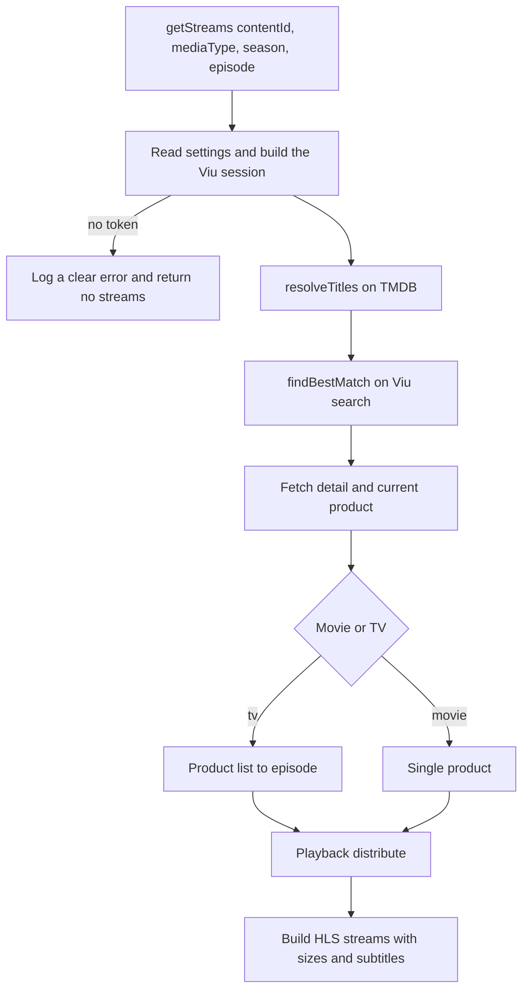

# Nuvio Viu Provider

[](manifest.json)
[](#-how-it-works)
[](#-how-it-works)
[](package.json)

A **Viu Indonesia** streaming provider for **Nuvio**, written as a plain JavaScript module and bundled with esbuild into a single file.

Nuvio passes a content id to the provider, which resolves the title with TMDB, searches **Viu's own web API** (`www.viu.com/ott/id`) and requests playback with **your own account cookie**. No third-party streaming API or external resolver is involved.

> **Premium cookie** · **Viu's own API** · **no hardcoded API keys** · **sandbox-ready**

---

## ✨ Features

- **Movies and series**, including absolute-numbered episodes.
- **Season-aware matching** — tries `Show Season N` first, because Viu often publishes each season as a separate series.
- **Premium playback** with your own `viu.com` cookie; its `token` is sent as a Bearer token, exactly like the web player does.
- **1080p / 720p / 480p / 240p** HLS variants with the file sizes Viu reports.
- **Viu subtitle tracks** (SRT), Indonesian and English first.
- **Strict title matching** — ambiguous or fuzzy Viu results are rejected instead of playing the wrong title or the wrong season.
- **Credential scoping** — the Viu cookie is only sent to Viu hosts; TMDB requests never carry account headers.
- **QuickJS friendly** — ES2020, no Node APIs, bounded request count and a 55 s internal budget.

---

## 📺 Provider

| ID | Provider | Source | Language | Format | Notes |
| --- | --- | --- | --- | --- | --- |
| `viu` | Viu | [viu.com/ott/id](https://www.viu.com/ott/id) | ID / EN | HLS | Movies and series, premium cookie required |

Supports both `movie` and `tv`.

---

## 🚀 Quick Start

**Requirements:** Node.js 18+ and npm.

```bash
npm install
npm run build
```

Try the provider straight from the terminal:

```bash
TMDB_API_KEY=<your-key> npm run preview -- 286794 tv 1 1
TMDB_API_KEY=<your-key> npm run preview -- 729854 movie
```

```text
viu: 4 stream(s) in 1236ms
- 1080p | hls | Episode 1 • 1080p | 5 sub(s)
  https://dms-api.viu.com/vod/vuclip_vod.m3u8?cdn=byteplus&vid=1166240379...
- 720p | hls | Episode 1 • 720p | 5 sub(s)
  https://dms-api.viu.com/vod/vuclip_vod.m3u8?cdn=byteplus&vid=1166240379...
```

> `preview` runs the built bundle inside a `node:vm` sandbox that mirrors the Nuvio runtime. Set `TMDB_API_KEY` in your environment (Nuvio injects the same key at runtime), and place your cookie in `cookies.txt` or pass `--cookie <file>` / `--lang id|en`.

---

## 📦 Installing in Nuvio

1. Run `npm run build` so `providers/` contains the latest bundle.
2. Host this folder at a public URL (GitHub raw, a static host, or a local server). The URL must expose `manifest.json`.
3. In Nuvio open **Settings → Content & Discovery → Plugins** and add the repository URL, for example:

   ```text
   https://raw.githubusercontent.com/<owner>/<repo>/main/
   ```

4. Refresh, enable **Viu**, then open its settings and paste your cookie.

---

## 🔐 Settings

| Setting | Description |
| --- | --- |
| **Cookie** | `viu.com` cookie. Paste a `Cookie:` header (`token=...; user_id=...`) or the full contents of a `cookies.txt` export. Only `token` is strictly required for playback; `user_id`, `user_level`, `areaId` and `countryCode` are used when present. |
| **Metadata language** | `Bahasa Indonesia` (language flag 8) or `English` (language flag 3). Used for Viu search/detail requests. |
| **Include Viu subtitles** | Attach the subtitle tracks Viu returns for the selected product. |

### Getting the cookie

1. Sign in at `https://www.viu.com` in a desktop browser.
2. Open DevTools → **Application → Storage → Cookies → `https://www.viu.com`**.
3. Copy the `token` cookie (and optionally `user_id`, `user_level`, `areaId`, `countryCode`).
4. Paste it into the provider settings as `token=...; user_id=...; user_level=2`.

A `cookies.txt` export from any cookie-export extension also works: paste the whole file, including the `# Netscape HTTP Cookie File` header.

The cookie is stored by Nuvio in the plugin settings. It is never part of this repository; `cookies.txt` is ignored by Git.

---

## ⚙️ How It Works



1. **Nuvio calls** `getStreams(contentId, mediaType, season, episode)`.
2. **The session is built** from the plugin settings: cookie jar, Bearer token, region and language flag.
3. **Titles are resolved** from TMDB — primary, original, and alternative titles with Indonesian variants first.
4. **Viu is searched** with `Show Season N` first for later seasons, then the remaining title variants.
5. **The best candidate is chosen** with a strict score; trailers, teasers and the wrong season are rejected.
6. **The detail and episode list** give the product that actually holds the stream.
7. **Playback is requested** from Viu and every returned quality becomes a Nuvio stream.

Endpoints used (all owned by Viu):

| Endpoint | Purpose |
| --- | --- |
| `https://api-gateway-global.viu.com/api/mobile?r=/search/video` | Title search |
| `https://api-gateway-global.viu.com/api/mobile?r=/vod/detail` | Series/product detail, subtitles |
| `https://api-gateway-global.viu.com/api/mobile?r=/vod/product-list` | Episode list |
| `https://api-gateway-global.viu.com/api/playback/distribute` | Playback URLs |

Every request sends `area_id=1000`, `language_flag_id`, `countryCode=ID`, the cookie and `Authorization: Bearer <token>`.

TMDB is used only to turn a content id into a title. Nuvio injects `TMDB_API_KEY`; this repository ships no keys.

---

## 📄 Provider Contract

Every bundle exposes a single entry function:

```js
export async function getStreams(contentId, mediaType, season, episode) { ... }
```

| Parameter | Type | Description |
| --- | --- | --- |
| `contentId` | `string` | `tmdb:123`, `imdb:tt123`, or a bare number |
| `mediaType` | `string` | `movie` or `tv` |
| `season` | `number \| null` | Season number |
| `episode` | `number \| null` | Episode number |

Returns `Promise<Stream[]>`; an empty array means no playable stream was found.

```ts
type Stream = {
  name: string;        // "Viu"
  title: string;       // "Episode 1 • 1080p" or "Movie • 1080p"
  url: string;         // HLS manifest
  quality: string;     // "1080p", "720p", "480p", "240p"
  type: 'hls';
  language: string;    // "id"
  provider: string;    // "viu"
  size?: string;       // "1.2 GB", when Viu reports it
  headers: Record<string, string>; // User-Agent, Referer
  subtitles?: Array<{ url: string; language: string; name?: string; headers?: Record<string, string> }>;
};
```

The `hasSettings` flag in `manifest.json` makes Nuvio call the exported `onSettings()` and render the settings UI.

---

## 🧩 Project Structure

```text
Viu/
├── build.mjs            # esbuild bundler (IIFE, one output per provider)
├── biome.json           # Biome config (lint + format verification)
├── manifest.json        # Provider metadata read by Nuvio
├── package.json
├── providers/           # Build output — do not edit by hand
├── src/
│   ├── shared/          # http, log, media, text, tmdb
│   └── viu/
│       ├── config.js    # Base URLs, region, languages, qualities, limits
│       ├── session.js   # Cookie parsing, session, request headers
│       ├── client.js    # Viu gateway client (search, detail, products, playback)
│       ├── matching.js  # Strict Viu search scoring
│       ├── playback.js  # Episodes, subtitles, stream objects
│       ├── provider.js  # getStreams orchestration
│       ├── settings.js  # Settings UI layout
│       └── index.js     # Entry point (exports getStreams / onSettings)
├── tools/
│   └── preview.mjs      # CLI to test the provider in a Nuvio-like sandbox
└── cookies.txt          # Your account cookie (ignored by Git)
```

Files in `providers/` are **generated** by `build.mjs` and start with a warning banner. Change code in `src/`, not there.

---

## 🛠️ Commands

| Command | Description |
| --- | --- |
| `npm install` | Install dependencies (`esbuild`, `@biomejs/biome`) |
| `npm run build` | Bundle the provider into `providers/` |
| `npm run watch` | Rebuild automatically when `src/` changes |
| `npm run lint` | Verify lint and formatting with Biome (fails on warnings) |
| `npm run lint:fix` | Apply Biome's safe fixes and formatting |
| `npm run preview -- <content-id> [movie\|tv] [season] [episode] [--json] [--cookie <file>] [--lang id\|en]` | Run the bundle in the local sandbox |

---

## ⚠️ Notes & Limitations

- **Region**: only the Viu Indonesia area (`area_id=1000`).
- **Cookie expiry**: when Viu invalidates the session, playback returns HTTP 400/401 and the provider returns no streams. Re-copy the cookie.
- **Season mapping**: Viu often publishes each season as a separate series. The provider searches `Show Season N` first; if the series uses continuous episode numbering, it matches the absolute episode number.
- **DRM titles**: streams flagged `is_drm` by Viu (Widevine) are skipped because a plugin cannot supply a license.
- **Subtitles**: Viu serves SRT without a file extension. Nuvio's subtitle loader defaults unknown extensions to SubRip, which matches the payload. Subtitles are ignored on Nuvio TV (the app does not render plugin subtitles on TV).
- **Metadata**: title matching depends on TMDB. Titles missing from TMDB, or with no matching Viu catalog entry, return no streams by design. Tracker ids (`kitsu:`, `mal:`, `anilist:`, `anidb:`, `tvdb:`) are not resolved; use a TMDB-backed entry.
- **Runtime**: code runs in a lightweight sandbox — only `fetch` and the helpers in `src/shared/` are available. Nuvio TV has no `setTimeout`, `Buffer` or `TextEncoder`; do not add timers or Node APIs.
- **Maintenance**: keep the `manifest.json` version and the scraper version in sync when behaviour changes, and keep the 820 match threshold plus the trailer/teaser rejection when editing the scorer.

---

## 🩺 Troubleshooting

| Symptom | Check |
| --- | --- |
| `Missing Viu cookie token` | Paste a cookie that contains `token=...`; do not paste only `session_id`. |
| No streams for a valid title | The title may not be in the Viu ID catalog; check the logs for the matched query and score. |
| Playback fails after some time | The Viu session expired; copy a fresh `token` cookie. |
| Wrong season/episode | Viu may publish seasons as separate series without a `Season N` suffix; check the episode list numbering. |
| `TMDB_API_KEY is not available` | Nuvio normally injects it; for local previews set it in your environment. |

---

## 🔒 Security & Disclaimer

- This provider is for personal use with your own Viu account. Respect Viu's terms of service and local law.
- Do not commit `cookies.txt` or any session cookie. The repository ignores it.
- The provider does not bypass DRM or payments; it only requests the same playback URLs the web player uses for the authenticated account.

---

## 🙏 Credits

Made by **Kurumi**. Built with [esbuild](https://esbuild.github.io/).
